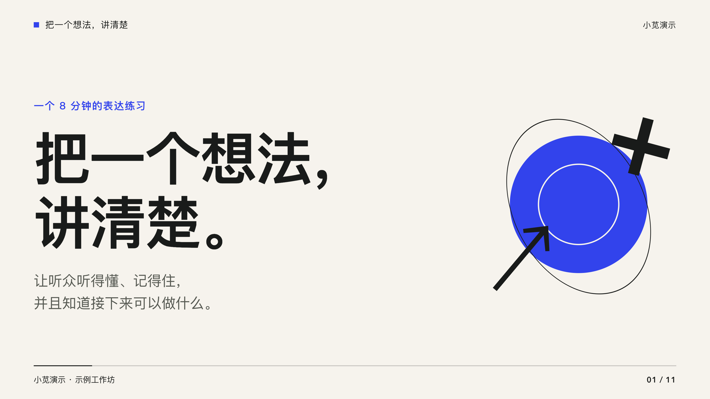
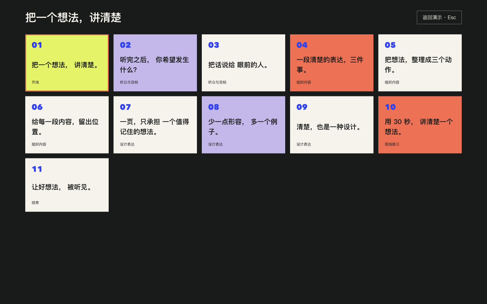
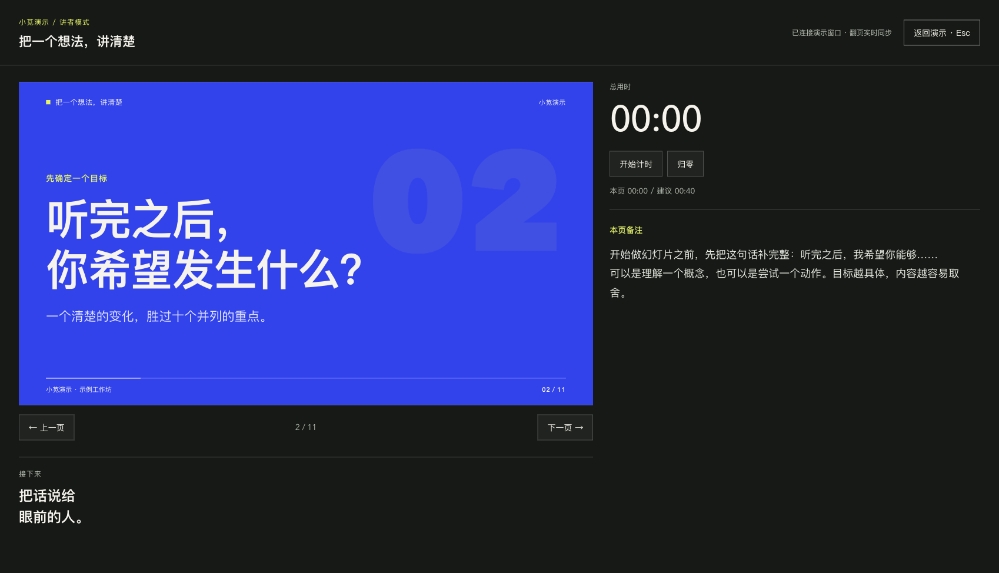

# 小苋演示

**把文章、大纲和零散素材，变成有设计感、能离线播放的 HTML 演示。**

打开浏览器就能讲：大标题、清楚的层级、页面切换、快捷键、目录、全屏和讲者备注。想要换内容，把素材交给 AI；想要自己改，也可以直接编辑内容文件。



[在线体验](https://rosehahah.github.io/xiaoxian-slides/) · [下载完整项目](https://github.com/rosehahah/xiaoxian-slides/archive/refs/heads/main.zip) · [下载即播 HTML](https://github.com/rosehahah/xiaoxian-slides/releases/latest/download/demo.html) · [可直接复制的提示词](docs/prompts.md)

## 这是什么？

这是一个开源的 **AI 演示制作工具包**，里面有三样东西：

| 内容 | 你得到什么 |
|---|---|
| Skill | 一份给 AI 的制作指南：怎么组织内容、选版式、写讲者备注、检查结果 |
| HTML 模板与播放器 | 一套稳定的演示界面：翻页、切换、目录、全屏、快捷键、讲者窗口 |
| 示例与说明 | 一份打开就能看的演示，以及从下载到生成的操作步骤 |

**HTML 是交付文件，Skill 是制作方法。** 它们一起使用：AI 按 Skill 整理你的内容，再用模板生成 HTML。生成后的 HTML 可以单独分享，接收者不需要安装 Skill。

HTML 可以理解成“用浏览器打开的一份演示文稿”。它仍然是一页一页讲的演示，不需要搭建网站或购买服务器。

## 适合什么场景？

- **分享与授课：** 把文章、经验或知识点变成观众看得懂、讲者讲得顺的页面。
- **项目介绍与路演：** 讲清问题、方案、证据和下一步。
- **工作复盘与汇报：** 用对比、步骤和时间线组织材料。
- **内容展示：** 把长文里的重点提炼成适合现场讲述的形式。

如果你需要继续在 PowerPoint 中逐个编辑文字与形状，请使用其他可编辑 PPTX 工作流。本项目第一版导出的 PPTX 每页是一张图片。

## 先花一分钟，看一下效果

可以先点 [在线体验](https://rosehahah.github.io/xiaoxian-slides/) 试翻页。想保存到电脑，按下面操作。**下载后的播放无需 AI、账号、Node.js，也无需联网。**

1. 点击本页上方的 **「下载完整项目」**。也可以点击 GitHub 页面的绿色 **Code** 按钮，再选 **Download ZIP**。
2. 解压下载的 ZIP 文件。不要直接在压缩包里打开文件。
3. 进入解压后的文件夹，再进入 `examples` 文件夹。
4. 找到 **`demo.html`**，用 Chrome、Edge、Safari 或 Firefox 打开。通常双击就可以。
5. 按方向键翻页，按 `?` 查看帮助，按 `F` 全屏。

GitHub 上直接点击 HTML 文件通常会看到代码；**下载后用浏览器打开**，才能看到演示画面。

## 能做到什么效果？

这套模板提供纸色、蓝色、墨黑、荧光黄和暖珊瑚色主题，以及八种页面：封面、观点、双栏、卡片、步骤、时间线、引用、结尾。整体采用杂志式排版，让标题、图像和留白形成讲述节奏。

| 形式 | 能做到什么 | 适合用来 |
|---|---|---|
| HTML | 页面切换、快捷键、目录、全屏、讲者备注、本地图片内嵌 | 现场演示、自己排练、分享给他人 |
| PDF | 静态页面，方便阅读与打印 | 会后资料、归档 |
| 图片版 PPTX | 每页是一张图片，可在 PowerPoint 中播放；可包含讲者备注 | 要求提交 `.pptx` 的场合 |
| JSON | 保存标题、正文、图片路径与备注，可继续修改并生成 | 让 AI 迭代、自己维护内容 |

HTML 的动画与交互仅在浏览器里保留。PDF 和图片版 PPTX 是静态导出；PPTX 的文字不能单独修改。

## 想做自己的演示：把素材交给 AI

你需要一个**能读取本地文件、执行命令的 AI 工具**，以及 Node.js 20 或更新版本。不确定电脑上有没有 Node.js，可以让 AI 检查。没有时从 [Node.js 官网](https://nodejs.org/)安装当前 LTS 版本，再重新打开 AI 工具。

本项目无需 API key、插件账号或在线服务。生成过程使用你自己的 AI 工具，其费用和使用限制由该工具决定；播放已经生成的 HTML 不需要 AI。

### 方法一：下载后直接使用

这是第一次体验时最简单的方式，无需先安装 Skill。

1. 按上面的步骤下载并解压项目。
2. 在 AI 工具中打开这个文件夹，或把该文件夹的位置告诉 AI。让它能访问你的文章、图片和其他材料。
3. 复制下面这段话，把方括号里的内容换成自己的信息，再附上素材：

```text
请读取这个项目的 README，以及 skills/xiaoxian-slides/SKILL.md，按小苋演示的方法制作。

把我的附件素材做成一份面向[受众]的[20]分钟分享。
目标是让大家[理解什么/学会什么/采取什么行动]。
沿用默认视觉风格，保留快捷键、目录、全屏和讲者备注。
没有来源的事实不要编造。请实际生成并检查 HTML，同时保留可修改的 JSON。
输出放到[文件夹]，完成后告诉我双击哪个文件就能播放。
```

4. 等待 AI 完成。它应该交给你 **HTML 和 JSON**；打开 HTML 看效果，用 JSON 继续修改。

还没有素材，可以先把 [这份练习需求](examples/brief.md) 交给 AI，走通一次从材料到演示的完整流程。

不熟悉终端也可以这样使用。AI 工具本身需要获得你选择的文件夹与命令执行权限；它只能读取实际可访问的材料。

### 方法二：安装为 Skill，以后反复使用

**在 Codex 中安装：** 复制下面这段话给 Codex：

```text
使用 $skill-installer，从 GitHub 仓库 rosehahah/xiaoxian-slides 安装 skills/xiaoxian-slides 这个 Skill。
```

安装完成后，按安装器的提示重新启动或重新打开 Codex。之后制作时可以直接说：

```text
使用 $xiaoxian-slides，把这篇文章做成 15 分钟的分享。
面向第一次接触这个主题的人，保留讲者备注，输出可离线播放的 HTML 和 JSON。
```

**手动安装：** 将项目里的整个 `skills/xiaoxian-slides` 文件夹复制到：

| 系统 | Skill 目录 |
|---|---|
| macOS / Linux | `~/.agents/skills/` |
| Windows | `%USERPROFILE%\.agents\skills\` |

安装后的结构应是 `.../skills/xiaoxian-slides/SKILL.md`。请复制整个文件夹，脚本和模板也在里面；仅复制 `SKILL.md` 无法构建。

其他 AI 工具是否自动发现此目录，取决于它自己的 Skill 支持方式。只要能读取本地文件并执行 Node.js 命令，也可以直接告诉它 `SKILL.md` 的实际路径，按「方法一」使用。

## 怎样修改生成结果？

把新的要求交给 AI，并提供上一次生成的 JSON 文件：

```text
请修改这份 slides.json：
第 3 页字太多，拆成两页；第 5 页改成两列对比；结尾加一个明确的行动。
重新生成 HTML，并检查改动后的页面。保留原来的快捷键、目录和讲者备注。
```

也可以自己修改 JSON 中的 `title`（标题）、`body`（正文）、`items`（条目）、`notes`（备注）等字段，再运行构建命令。JSON 修改后，已有 HTML 不会自动更新，需要重新构建。

[更多可复制的提示词](docs/prompts.md) · [完整数据格式与最小示例](skills/xiaoxian-slides/references/data-format.md)

## 播放时怎么操作？

| 按键 | 操作 |
|---|---|
| `→` / `↓` / `Space` / `Page Down` | 下一页 |
| `←` / `↑` / `Page Up` | 上一页 |
| `Home` / `End` | 第一页 / 最后一页 |
| `F` | 进入或退出全屏 |
| `O` | 打开或关闭目录 |
| `P` | 打开讲者窗口 |
| `?` | 查看快捷键帮助 |
| `Esc` | 关闭面板、退出全屏；讲者模式下返回演示 |

移动设备可以左右滑动翻页。鼠标用户可以使用页面上的控制按钮；目录可以直接跳到指定页面。

**全屏只显示幻灯片。** 底部工具栏和提示不会显示，也不占用画面空间；按 `F` 或 `Esc` 退出。普通模式下，工具栏闲置约 3 秒自动隐藏，移动鼠标、触摸或按 `Tab` 可重新显示。画面按完整窗口等比居中，屏幕比例不同时只保留必要的对称留边。

**双屏演示：** 按 `P` 打开讲者窗口，将它留在自己的屏幕；把主演示窗口放到投影屏，再按 `F` 全屏。讲者窗口用于查看备注与时间提示。如果浏览器阻止弹窗，请允许当前演示文件弹出窗口后再试。

**目录：** 按 `O` 打开整屏卡片总览，查看页码、标题和章节；当前页以荧光黄底和珊瑚色边框标出。点击卡片或用方向键选择后按回车跳转，按 `O`、`Esc` 或顶部“返回演示”关闭目录。长目录会自动定位到当前页。

<details>
<summary>看看卡片目录的实际画面</summary>



</details>

**退出讲者模式：** 点击右上角“返回演示 · Esc”或按 `Esc`，在当前窗口回到普通演示并保留当前页。旧计时和同步会话结束；之后可以再次按 `P` 开启讲者模式。即使原来的演示窗口已关闭，也可以返回。讲者窗口全屏时，先按一次 `Esc` 退出全屏，再按一次返回演示。

<details>
<summary>看看讲者窗口的实际画面</summary>



</details>

## 熟悉命令行？一条命令生成 HTML

先在终端进入解压后的项目文件夹。**构建 HTML 零 npm 依赖，只需 Node.js 20+。**

```bash
node skills/xiaoxian-slides/scripts/build.mjs examples/demo.json -o examples/demo.html
```

将 `examples/demo.json` 换成自己的 JSON 路径，将 `examples/demo.html` 换成期望的输出路径。路径包含空格时加英文双引号，例如：

```bash
node skills/xiaoxian-slides/scripts/build.mjs "my slides/content.json" -o "my slides/slides.html"
```

### 可选：导出 PDF 和图片版 PPTX

只在需要导出时安装依赖。首次在项目根目录运行：

```bash
npm install
npx playwright install chromium
```

然后运行：

```bash
node skills/xiaoxian-slides/scripts/export.mjs examples/demo.html --out-dir output
```

导出需要本地 Chromium 浏览器，首次安装依赖与浏览器需要联网。安装好后，本地素材的构建与导出均不依赖在线服务。不会操作时，把这段说明交给 AI 帮你执行。

如果你只安装了 Skill，没有完整项目，把 `<Skill目录>` 换成实际安装路径后运行：

```bash
npm install --prefix "<Skill目录>" --no-save playwright@1.62.1 pptxgenjs@4.0.1
npm exec --prefix "<Skill目录>" -- playwright install chromium
node "<Skill目录>/scripts/export.mjs" "你的演示.html" --out-dir output
```

只要 PDF 或 PPTX 时，在导出命令末尾加 `--format pdf` 或 `--format pptx`；默认同时生成两种。

## 项目里有哪些文件？

```text
xiaoxian-slides/
├── README.md                         从这里开始
├── examples/
│   ├── demo.html                     打开即播的完整示例
│   ├── demo.json                     示例的可修改内容
│   └── brief.md                      填好后交给 AI 的需求单
├── docs/
│   ├── preview.png                   页面预览
│   └── prompts.md                    可直接复制的提示词
├── skills/xiaoxian-slides/
│   ├── SKILL.md                      AI 制作指南
│   ├── agents/openai.yaml            Codex 中显示的名称与提示
│   ├── references/
│   │   ├── design-rules.md           审美与版式选择
│   │   └── data-format.md            内容格式
│   ├── assets/                       HTML 模板与播放器
│   └── scripts/
│       ├── build.mjs                 生成独立 HTML
│       └── export.mjs                导出 PDF 与图片版 PPTX
└── LICENSE                           MIT 开源许可证
```

## 常见问题

**我完全不会写代码，能用吗？**

能。看示例只需要下载、解压、双击；制作自己的演示，可以让能访问文件和运行命令的 AI 工具完成。先试「方法一」，不用理解 JSON。

**我点开 HTML 看到的是一堆代码。**

如果是在 GitHub 页面上看到代码，请下载、解压，再用浏览器打开本地 `demo.html`。如果本地默认用文本编辑器打开，右键文件，选择“打开方式”，再选择浏览器。

**我可以直接把 HTML 发给别人吗？**

可以。构建器会内嵌模板、播放器、本地图片和讲者备注；接收者下载后用浏览器打开即可，也能查看备注。要只分享画面，可分享 PDF。聊天软件内的预览可能不支持交互，请保存到本地再打开。要继续改内容时，同时保存 JSON 和原始图片。

**断网还能播放吗？**

能。生成后的 HTML 不加载在线字体、脚本或图片。已经写入页面的外部链接，点击后访问目标页面仍需要联网。

**需要 OpenAI API key 吗？**

不需要。本项目负责模板与构建；你用的 AI 工具负责理解材料和写内容。AI 工具自己的账号、费用和权限按其规定使用。

**为什么我的字体和预览略有不同？出现乱码怎么办？**

模板使用系统字体，不同设备的字形可能不同。请使用现代浏览器，并以 UTF-8 保存 JSON；不要用会自动改编码或替换英文引号的软件编辑 JSON。出现构建报错时，将报错和文件交给 AI 检查。

**讲者窗口打不开，或者双屏没同步。**

先允许弹窗，在主演示窗口按 `P` 打开讲者窗口。两个窗口保持打开；从同一份主演示启动，不要分别打开两份 HTML。浏览器或系统对本地文件窗口通信可能有限制，演讲前请在现场设备上试一次。

**导出的 PPTX 能编辑吗？还有动画吗？**

第一版每页是一张图片，可以移动、缩放或替换整页图片，不能逐字编辑。页面切换动画、快捷键和目录保留在 HTML 中；PDF 与 PPTX 为静态页面。

**图片怎么放进去？**

提供本地 PNG、JPEG、WebP 或 GIF，并在 JSON 的 `image` 中填写相对 JSON 文件的路径。单张图片不超过 15 MB，SVG 请先转成 PNG。AI 可以帮你处理。构建完成后图片会内嵌，不会因为移动 HTML 丢失；JSON 重新构建时仍需要原图。

**为什么 AI 只交给我 JSON？**

JSON 只是内容。让它继续按 Skill 实际执行构建、打开检查，并交付 HTML。如果它不能访问文件或执行命令，换到支持这些能力的工具，或者由你运行上面的命令。

## 开源与素材

代码、模板、Skill 和项目文档使用 [MIT License](LICENSE)，可以使用、修改与商用，分发时请保留许可证。示例用于演示公开工作流；你加入的照片、字体、图标、文章等素材可能有各自授权，公开或商用时请确认来源。项目内素材说明见 [NOTICE.md](NOTICE.md)。

欢迎通过 [Issues](https://github.com/rosehahah/xiaoxian-slides/issues) 反馈问题。描述你做了什么、期望什么、实际发生什么；方便时附浏览器版本、报错或去除私人内容的示例文件。

## 开发与验证

构建器使用 Node.js 标准库；可选导出和浏览器回归依赖锁定在 `package-lock.json` 中。安装导出依赖和 Chromium 后，运行 `npm test`。测试覆盖离线资源、全部版式、键盘与触摸、全屏、弹层焦点、讲者同步、独立窗口隔离、计时、窄屏、打印，以及导出页数、比例和备注。

本机验证环境为 macOS、Node.js 22 与 Chromium。GitHub Actions 还会在 Linux 中构建和导出示例，检查结果见 [Actions](https://github.com/rosehahah/xiaoxian-slides/actions)。Safari、Firefox 的具体窗口通信行为请在现场设备上预演。
